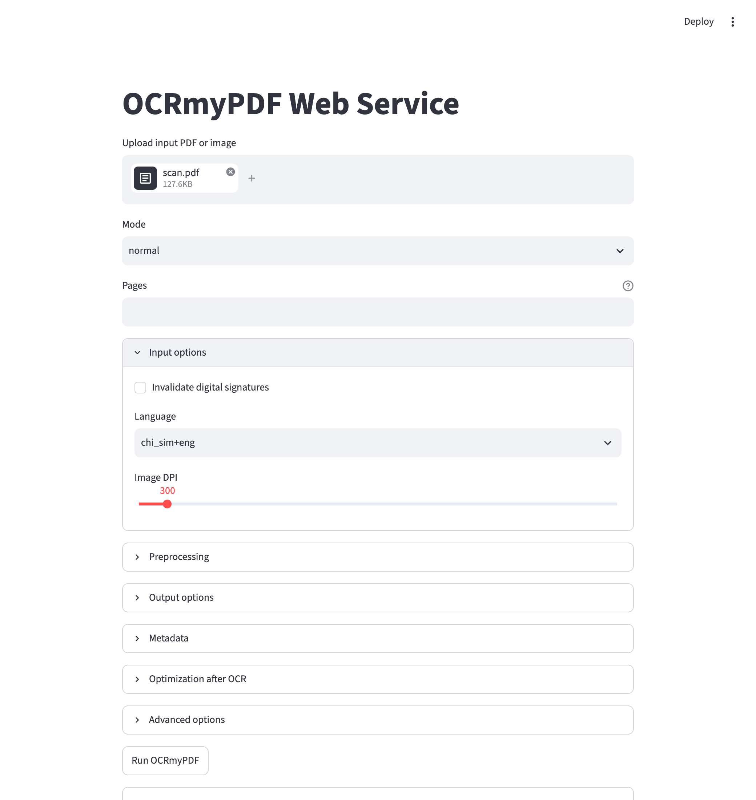

# 扫描 PDF 可搜索化（OCRmyPDF）

> 篝火出品 · 基于开源项目 [ocrmypdf/OCRmyPDF](https://github.com/ocrmypdf/OCRmyPDF)（MPL-2.0）

给扫描件（没有文字层、只有图片的 PDF）加上一层看不见的文字，之后就能搜索、复制文字。识别在本机完成，文件不上传。启动后在浏览器里打开上游自带的本机网页界面，上传 PDF，点一下按钮，下载处理好的 PDF。



## 使用前必读

- **必须先装 Tesseract**（识别引擎，Apache-2.0，不随本工具打包）：
  - Mac：`brew install tesseract`
  - Windows：`winget install UB-Mannheim.TesseractOCR`，或到 https://github.com/UB-Mannheim/tesseract/wiki 下载安装包，按默认路径安装即可。
- **Ghostscript 可选**：上游 v17 起不再强制需要 Ghostscript（用 pypdfium2 渲染页面，并自行生成 PDF/A）。Ghostscript 是 AGPL 协议，所以本工具不要求安装。需要它时（例如个别文件转 PDF/A 失败）：Mac `brew install ghostscript`，Windows 到 https://ghostscript.com/releases/gsdnld.html 下载安装。
- **中文识别数据**：第一次启动脚本会自动下载 Tesseract 的 `eng`、`osd`、`chi_sim`（简体中文）、`chi_tra`（繁体中文）语言数据（来自 tesseract-ocr/tessdata_fast，约 17 MB）到解压出来的 `tessdata` 文件夹，不改动你系统里的 Tesseract。
- 网页界面是英文（上游原样）。语言下拉框里选 `chi_sim+eng`（简体中文 + 英文，默认）、`eng`、`chi_tra+eng`、`chi_sim`。
- 需要联网：首次启动会下载 uv、Python 3.12、依赖和语言数据。

## 下载与运行

到 [Releases](https://github.com/campfire-code/searchable-pdf/releases/latest) 下载 `searchable-pdf_版本号_portable.zip`，解压后：

- **Windows**：双击 `启动（Windows 双击）.bat`
- **Mac**：双击 `启动（Mac 双击）.command`（第一次可能要在「系统设置 → 隐私与安全性」里允许打开）

第一次运行安装几分钟；之后启动很快，并自动打开浏览器 http://127.0.0.1:8501 。关闭启动窗口即退出。

## 怎么用

1. 把扫描 PDF 拖到「Upload input PDF or image」。
2. 展开 `Input options`，确认 `Language`（中英混排保持默认 `chi_sim+eng`）。
3. 点 `Run OCRmyPDF`，等进度日志跑完，点 `Download output PDF`。
4. 已经有文字层的页面会报错停止；要跳过它们选 Mode 里的 `skip-text`，要强制重新识别选 `force-ocr`。其余选项（纠偏、转正、清理、PDF/A、压缩）含义见上游文档。
5. 想批量处理一个文件夹，可用命令行 `ocrmypdf`，或上游 `misc/batch.py`、`misc/watcher.py`（需要自己配好环境，篝火没有验证）。

## 验收用例

用图片生成一份没有文字层的 PDF，内容写「示例：扫描件可搜索化测试」「这是一份没有文字层的合同样本，付款期限为三十日。」和两行英文：

| 操作 | 应得到 |
|---|---|
| 处理前 `pdftotext scan.pdf -` | 几乎没有文字 |
| 网页里选 `chi_sim+eng` 处理，下载结果后 `pdftotext out.pdf -` | 能提取出上述中英文句子；用 PDF 阅读器搜「示例」「Invoice」能命中 |

篝火本机实测（Mac，Tesseract 5 + tessdata_fast 的 chi_sim）：中英文都识别正确；中文逗号被识别成半角逗号加空格（「样本 , 付款」），属于 tessdata_fast 的小瑕疵，换 `tessdata_best` 的 chi_sim 数据通常更准（自行替换 `tessdata` 文件夹里的 `chi_sim.traineddata`）。只测了清晰的印刷体样例，手写、模糊、复杂版面的效果请自己用实际文件试。

> 提示：系统里没有 CJK 字体时，上游会把中文文字层做成不可见层（仍可搜索复制，只是在阅读器里高亮时看不到字形），属于正常现象。

## 可选：换成 RapidOCR 引擎

上游支持第三方 OCR 插件。社区插件 [ocrmypdf-rapidocr](https://pypi.org/project/ocrmypdf-rapidocr/)（MIT，基于 Apache-2.0 的 RapidOCR）篝火本机试过：在启动脚本建好的环境里执行 `uv pip install ocrmypdf-rapidocr`，命令行加 `--plugin ocrmypdf_rapidocr -l chi_sim`，同一份样例中英文都识别正确。注意：该插件只允许一种语言；个人维护、很新（2026-06 发布，仓库 0 星），首次运行要下载识别模型；网页界面没有这个选项，需用命令行。默认不安装。

## 和上游的区别

- 新增中文说明、`tool.json`、`.github/workflows/release.yml`、`campfire/` 启动脚本，以及两个辅助脚本 `campfire_setup.py`（检查 Tesseract、下载语言数据）和 `campfire_run.py`（设置语言数据路径并启动网页界面）。移除了上游的工作流。
- 安装的是 PyPI 上的上游 v17.13.0 发布包（`ocrmypdf==17.13.0`），不是源码目录。
- 改了上游网页界面 `misc/_webservice.py`（该文件按上游声明是 AGPL-3.0-or-later，改动同样以该协议开放），共 4 处：
  1. 语言下拉框由 `eng/deu/fra/spa` 改为 `chi_sim+eng / eng / chi_tra+eng / chi_sim`；
  2. 去掉「点击时按钮已被禁用」的逻辑（新版 streamlit 下点了按钮没有任何反应）；
  3. 输入输出文件改用临时目录（Windows 上不能让子进程打开仍被占用的临时文件）；
  4. 日志按 UTF-8 解码。
- 上游自己的网页界面只是示例性质的小服务，没有鉴权，只监听本机 127.0.0.1，请不要对外开放。

## 归属与许可证

本仓库由**篝火**整理发布。OCRmyPDF 的版权归 James R. Barlow 等原作者所有，核心按 **MPL-2.0** 分发，仓库内各文件的许可证见 `LICENSES/` 目录和 `REUSE.toml`（文档为 CC-BY-SA-4.0，`misc/webservice.py` 与 `misc/_webservice.py` 为 AGPL-3.0-or-later）。依赖：Tesseract（Apache-2.0，需自行安装）、Ghostscript（AGPL-3.0，可选，需自行安装）、streamlit（Apache-2.0）。语言数据来自 tesseract-ocr/tessdata_fast（Apache-2.0）。全部工具目录见 [toolkit-hub](https://github.com/campfire-code/toolkit-hub)。

---

以下为上游原始说明：

<!-- SPDX-FileCopyrightText: 2014 Julien Pfefferkorn -->
<!-- SPDX-FileCopyrightText: 2015 James R. Barlow -->
<!-- SPDX-License-Identifier: CC-BY-SA-4.0 -->


[](https://github.com/ocrmypdf/OCRmyPDF/actions/workflows/build.yml) [![PyPI version][pypi]](https://pypi.org/project/ocrmypdf/) ![Homebrew version][homebrew] ![ReadTheDocs][docs] ![Python versions][pyversions]

[pypi]: https://img.shields.io/pypi/v/ocrmypdf.svg "PyPI version"
[homebrew]: https://img.shields.io/homebrew/v/ocrmypdf.svg "Homebrew version"
[docs]: https://readthedocs.org/projects/ocrmypdf/badge/?version=latest "RTD"
[pyversions]: https://img.shields.io/pypi/pyversions/ocrmypdf "Supported Python versions"

OCRmyPDF adds an OCR text layer to scanned PDF files, allowing them to be searched or copy-pasted.

```bash
ocrmypdf                      # it's a scriptable command line program
   -l eng+fra                 # it supports multiple languages
   --rotate-pages             # it can fix pages that are misrotated
   --deskew                   # it can deskew crooked PDFs!
   --title "My PDF"           # it can change output metadata
   --jobs 4                   # it uses multiple cores by default
   --output-type pdfa         # it produces PDF/A by default
   input_scanned.pdf          # takes PDF input (or images)
   output_searchable.pdf      # produces validated PDF output
```

[See the release notes for details on the latest changes](https://ocrmypdf.readthedocs.io/en/latest/release_notes.html).

## Main features

- Generates a searchable [PDF/A](https://en.wikipedia.org/?title=PDF/A) file from a regular PDF
- Places OCR text accurately below the image to ease copy / paste
- Keeps the exact resolution of the original embedded images
- When possible, inserts OCR information as a "lossless" operation without disrupting any other content
- Optimizes PDF images, often producing files smaller than the input file
- If requested, deskews and/or cleans the image before performing OCR
- Validates input and output files
- Distributes work across all available CPU cores
- Uses [Tesseract OCR](https://github.com/tesseract-ocr/tesseract) engine to recognize more than [100 languages](https://github.com/tesseract-ocr/tessdata)
- Keeps your private data private.
- Scales properly to handle files with thousands of pages.
- Battle-tested on millions of PDFs.


For details: please consult the [documentation](https://ocrmypdf.readthedocs.io/en/latest/).

## Motivation

I searched the web for a free command line tool to OCR PDF files: I found many, but none of them were really satisfying:

- Either they produced PDF files with misplaced text under the image (making copy/paste impossible)
- Or they did not handle accents and multilingual characters
- Or they changed the resolution of the embedded images
- Or they generated ridiculously large PDF files
- Or they crashed when trying to OCR
- Or they did not produce valid PDF files
- On top of that none of them produced PDF/A files (format dedicated for long time storage)

...so I decided to develop my own tool.

## Installation

Linux, Windows, macOS and FreeBSD are supported. Docker images are also available, for both x64 and ARM.

| Operating system              | Install command               |
| ----------------------------- | ------------------------------|
| Debian, Ubuntu                | ``apt install ocrmypdf``      |
| Windows Subsystem for Linux   | ``apt install ocrmypdf``      |
| Fedora                        | ``dnf install ocrmypdf``      |
| macOS (Homebrew)              | ``brew install ocrmypdf``     |
| macOS (MacPorts)              | ``port install ocrmypdf``     |
| macOS (nix)                   | ``nix-env -i ocrmypdf``       |
| LinuxBrew                     | ``brew install ocrmypdf``     |
| FreeBSD                       | ``pkg install py-ocrmypdf``   |
| OpenBSD                       | ``pkg_add ocrmypdf``          |
| Ubuntu Snap                   | ``snap install ocrmypdf``     |

For everyone else, [see our documentation](https://ocrmypdf.readthedocs.io/en/latest/installation.html) for installation steps.

## Languages

OCRmyPDF uses Tesseract for OCR, and relies on its language packs. For Linux users, you can often find packages that provide language packs:

```bash

# Debian/Ubuntu users
apt-cache search tesseract-ocr # Display a list of all Tesseract language packs
apt-get install tesseract-ocr-chi-sim  # Example: Install Chinese Simplified language pack


# Arch Linux users
pacman -S tesseract-data-eng tesseract-data-deu # Example: Install the English and German language packs

# OpenBSD users
pkg_info -aQ tesseract  # Display a list of all Tesseract language packs
pkg_add tesseract-cym  # Example: Install the Welsh language pack

# brew macOS users
brew install tesseract-lang

# Fedora users
dnf search tesseract-langpack # Display a list of all Tesseract language packs 
dnf install tesseract-langpack-ita # Example: Install the Italian language pack


```

You can then pass the `-l LANG` argument to OCRmyPDF to give a hint as to what languages it should search for. Multiple languages can be requested.

OCRmyPDF supports Tesseract 4.1.1+. It will automatically use whichever version it finds first on the `PATH` environment variable. On Windows, if `PATH` does not provide a Tesseract binary, we use the highest version number that is installed according to the Windows Registry.

## Documentation and support

Once OCRmyPDF is installed, the built-in help which explains the command syntax and options can be accessed via:

```bash
ocrmypdf --help
```

Our [documentation is served on Read the Docs](https://ocrmypdf.readthedocs.io/en/latest/index.html).

Please report issues on our [GitHub issues](https://github.com/ocrmypdf/OCRmyPDF/issues) page, and follow the issue template for quick response.

## Feature demo

```bash
# Add an OCR layer and require PDF/A
ocrmypdf --output-type pdfa input.pdf output.pdf

# Convert an image to single page PDF
ocrmypdf input.jpg output.pdf

# Add OCR to a file in place (only modifies file on success)
ocrmypdf myfile.pdf myfile.pdf

# OCR with non-English languages (look up your language's ISO 639-3 code)
ocrmypdf -l fra LeParisien.pdf LeParisien.pdf

# OCR multilingual documents
ocrmypdf -l eng+fra Bilingual-English-French.pdf Bilingual-English-French.pdf

# Deskew (straighten crooked pages)
ocrmypdf --deskew input.pdf output.pdf
```

For more features, see the [documentation](https://ocrmypdf.readthedocs.io/en/latest/index.html).

## Requirements

In addition to the required Python version, OCRmyPDF requires external program installations of Ghostscript and Tesseract OCR. OCRmyPDF is pure Python, and runs on pretty much everything: Linux, macOS, Windows and FreeBSD.

## Plugins

OCRmyPDF provides a plugin interface allowing its capabilities to be extended or replaced. Here are some plugins we are aware of:

- [OCRmyPDF-AppleOCR](https://github.com/mkyt/ocrmypdf-AppleOCR): replaces the standard Tesseract OCR engine with Apple Vision Framework. Requires macOS.
- [OCRmyPDF-EasyOCR](https://github.com/ocrmypdf/OCRmyPDF-EasyOCR): replaces the standard Tesseract OCR engine with EasyOCR, a newer OCR engine based on PyTorch. GPU strongly recommended.
- [OCRmyPDF-PaddleOCR](https://github.com/clefru/ocrmypdf-paddleocr): replaces the standard Tesseract OCR engine with PaddleOCR, a powerful GPU accelerated OCR engine.

[paperless-ngx](https://docs.paperless-ngx.com/) provides integration of OCRmyPDF into a searchable document management system.

## Press & Media

- [Going paperless with OCRmyPDF](https://medium.com/@ikirichenko/going-paperless-with-ocrmypdf-e2f36143f46a)
- [Converting a scanned document into a compressed searchable PDF with redactions](https://medium.com/@treyharris/converting-a-scanned-document-into-a-compressed-searchable-pdf-with-redactions-63f61c34fe4c)
- [c't 1-2014, page 59](https://heise.de/-2279695): Detailed presentation of OCRmyPDF v1.0 in the leading German IT magazine c't
- [heise Open Source, 09/2014: Texterkennung mit OCRmyPDF](https://heise.de/-2356670)
- [heise Durchsuchbare PDF-Dokumente mit OCRmyPDF erstellen](https://www.heise.de/ratgeber/Durchsuchbare-PDF-Dokumente-mit-OCRmyPDF-erstellen-4607592.html)
- [Excellent Utilities: OCRmyPDF](https://www.linuxlinks.com/excellent-utilities-ocrmypdf-add-ocr-text-layer-scanned-pdfs/)
- [LinuxUser Texterkennung mit OCRmyPDF und Scanbd automatisieren](https://www.linux-community.de/ausgaben/linuxuser/2021/06/texterkennung-mit-ocrmypdf-und-scanbd-automatisieren/)
- [Y Combinator discussion](https://news.ycombinator.com/item?id=32028752)

## Business enquiries

OCRmyPDF would not be the software that it is today without companies and users choosing to provide support for feature development and consulting enquiries. We are happy to discuss all enquiries, whether for extending the existing feature set, or integrating OCRmyPDF into a larger system.

## License

The OCRmyPDF software is licensed under the Mozilla Public License 2.0 (MPL-2.0). This license permits integration of OCRmyPDF with other code, included commercial and closed source, but asks you to publish source-level modifications you make to OCRmyPDF.

Some components of OCRmyPDF have other licenses, as indicated by standard SPDX license identifiers or the DEP5 copyright and licensing information file. Generally speaking, non-core code is licensed under MIT, and the documentation and test files are licensed under Creative Commons ShareAlike 4.0 (CC-BY-SA 4.0).

## Disclaimer

The software is distributed on an "AS IS" BASIS, WITHOUT WARRANTIES OR CONDITIONS OF ANY KIND, either express or implied.
